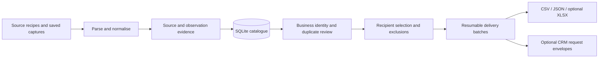

# Sector Prospector

A Python pipeline I built for sector-based business research and prospecting in Spain. It turns source records into a reviewable catalogue, with evidence, business identity, recipient deduplication and resumable delivery batches.

I use the system in my client-research work, including the pharmacy and real-estate projects. This repository publishes the reusable engine and synthetic examples. Real contacts, research captures, CRM state and campaign history are excluded.

**Stack:** Python, SQLite, standard-library HTTP/parsing and optional XLSX/PDF adapters. **Core:** no model API and no CRM account required.

## Try it offline

Requires **Python 3.12+**. From the repository root:

```sh
python -m sistema_prospeccion doctor
python -m examples.offline_demo
python -m unittest discover -s sistema_prospeccion/tests -p "test_*.py" -q
```

The demo creates a fresh folder under `work/`. It imports four fictional businesses, retries one record, keeps two businesses that share an email distinct, and exports CSV/JSON with pending and shared-recipient records identified. It makes no network or CRM calls.

For optional Excel output:

```sh
python -m pip install -r requirements-excel.txt
python -m examples.offline_demo --xlsx
```

CSV and XLSX exports retain the same 26-field contract. The public XLSX adapter uses `openpyxl`; the original internal exporter depended on a desktop runtime and is not included.

## Pipeline



## What the engine does

- **Preserves provenance.** Imported values retain their source and observation context. Frozen captures and extraction manifests can be checked by hash.
- **Separates business identity from email identity.** Two businesses sharing a domain or recipient are not automatically merged. Selection can avoid sending the same recipient twice without losing the underlying business records.
- **Tracks uncertainty.** Unknown website status, missing emails and unresolved identity stay explicit. A missing commercial signal is not filled with an invented need.
- **Resumes work.** SQLite state, stable identifiers, batch locks and previous-use exclusions support repeated runs and continued deliveries.
- **Exports reviewable data.** Main contacts, reserve, pending records and shared recipients remain distinct. Postal codes and phones stay text; spreadsheet formula-like values are protected.
- **Connects to a CRM through a contract.** The bridge prepares and applies bounded request/response envelopes. It does not contain credentials or a public deployment of my CRM.

## Optional integrations

The ordinary HTTP worker requires explicit network enablement. Source-route helpers can prepare Google Maps scraper or Scrapling commands; the corresponding external tools must be installed and available. Planning a route does not execute it. Fixture runs reject live route execution.

The Maps route supports native Docker and does not require a proxy. This repository does not bundle the external scraper, Scrapling or their browser dependencies. PDF extraction can use `requirements-pdf.txt`.

For CRM batch creation, provide your own project through `--project-id` or `PROSPECTOR_CRM_PROJECT_ID`. Tool envelopes target the documented bridge contract, not an arbitrary CRM API. No outbound email sender is part of this engine.

## Engineering and verification

Tests use temporary files, fictional businesses and simulated transports. They cover identity, idempotent imports, scope/publication checks, exclusion and reservation state, batches, exports and portable XLSX behaviour. CI runs on Python 3.12/3.13 on Linux and Windows.

The public suite uses synthetic fixtures; historical capture replays stay in the private workspace. Review source coverage and contact suitability before a live run.

## Repository map

| Path | Responsibility |
| --- | --- |
| `engine.py` | SQLite, provenance, identity, selection and export orchestration |
| `parsing.py`, `adapters.py`, `profiles.py` | Normalisation and source-specific extraction |
| `contacts.py`, `profile_io.py` | Contact evidence and frozen-capture verification |
| `network.py`, `source_routes.py`, `route_tools.py` | Bounded fetching and optional source tools |
| `campaigns.py`, `crm_bridge.py` | Reusable catalogues, delivery batches and CRM envelopes |
| `excel_export.py` | Portable optional XLSX adapter |
| `examples/offline_demo.py` | Runnable synthetic workflow |
| `sistema_prospeccion/tests/` | Public offline test suite |

The implementation files listed above are under `sistema_prospeccion/`.

This is a public extraction of an existing working system. Portability changes are recorded in [PUBLIC-EXTRACTION.md](PUBLIC-EXTRACTION.md); the private operational workspace is not replaced by this repository. No general reuse licence has been selected for the full engine yet.

[Ricardo Huertas](https://github.com/ricardohg1998-create) · [Portfolio](https://www.ricardohuertas.es/)
